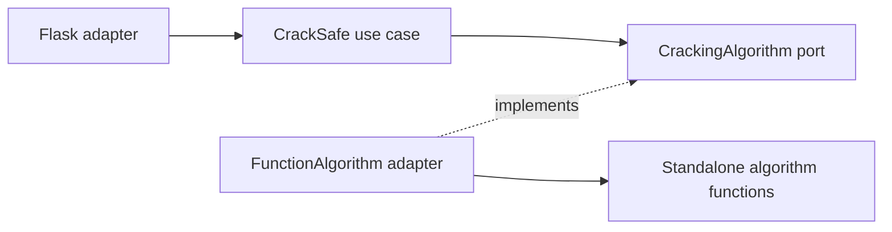

# Backend architecture

The backend uses ports and adapters around standalone algorithm functions. Each algorithm exposes `crack_safe(actual_combination, on_step=None)` and its own `sound_tool`; algorithms import only Python's standard library. A single-argument call returns the same final metrics. The optional observer reports algorithm events without depending on the application, Flask, or UI types.

| File | Responsibility |
| --- | --- |
| `backend/domain.py` | Combination validation and immutable metrics/results. |
| `backend/ports.py` | `CrackingAlgorithm`, the interface the application requires. |
| `backend/application.py` | `CrackSafe`: validate input, select an injected algorithm, and return the application result. |
| `backend/adapters/algorithms.py` | `FunctionAlgorithm`: call a standalone function, convert its metrics, and read its actual source. |
| `backend/adapters/steps.py` | Collect actual step events and bound the size of long permutation traces. |
| `backend/adapters/http.py` | Flask request parsing, JSON/SSE serialization, and HTTP error responses. |
| `backend/app.py` | Composition root: construct adapters, inject them into the use case, and create the Flask app. |
| `backend/positional.py`, `backend/backtracking.py`, `backend/regression.py` | Standalone algorithms. |

The use case depends on the port. Both adapters depend on the application contracts; the use case has no imports from Flask, concrete adapters, or algorithm implementations.



`backend/app.py` wires all three algorithms through the same adapter:

```python
app = create_app(
    CrackSafe(
        {
            "positional": FunctionAlgorithm(crack_positional),
            "backtracking": FunctionAlgorithm(crack_backtracking),
            "regression": FunctionAlgorithm(crack_regression),
        }
    )
)
```

The use case can be tested by injecting fake implementations of `CrackingAlgorithm`. HTTP tests can create an app with that same use case. Contract tests exercise the real wiring, including both POST route spellings and the source endpoint.

All algorithms return their final metrics. JSON calls run without recording steps. SSE calls request recording through the port; the function adapter injects an observer and returns the recorded steps alongside the metrics. The HTTP adapter sends those steps and the result after computation completes. It preserves the four-field JSON result contract. Expected input-validation errors become HTTP 400; unknown source requests become HTTP 404. The source adapter reads the entire running algorithm module, including both functions and imports.

Short runs retain every attempt. Long runs retain the first 256 attempts, every 4,096th attempt, and the final attempt. A regression inference event does not increment the attempt counter. Step playback runs entirely in the frontend and does not alter measured execution time or issue additional solver calls.

Regression requires a lock that uses every digit `0–9` exactly once. Its uniform-sequence baseline is known: a solved prefix of length `p` plus an unresolved candidate digit would score `p + 1`. The algorithm flips the current position and detects a regression when that candidate belongs there. It tests at most all but one remaining candidate per position, giving `9 + 8 + ... + 1 = 45` probes. The final code is inferred; an additional physical opening attempt is outside that total.
